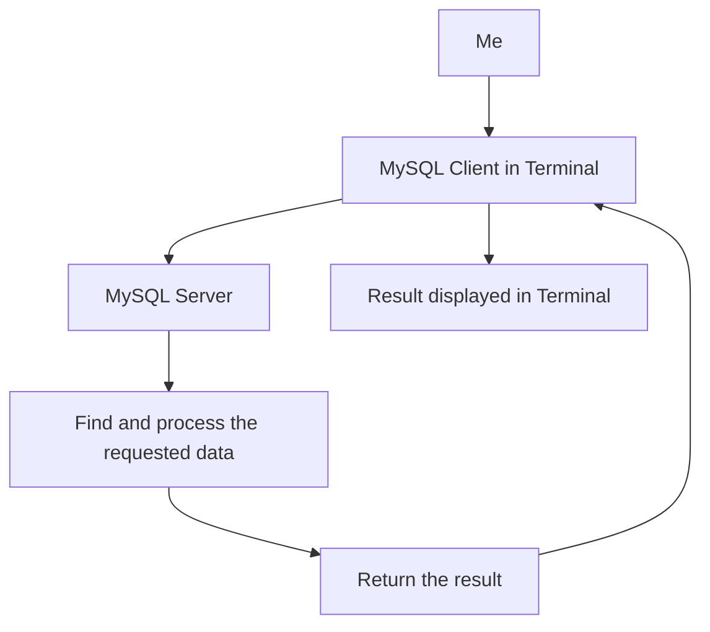
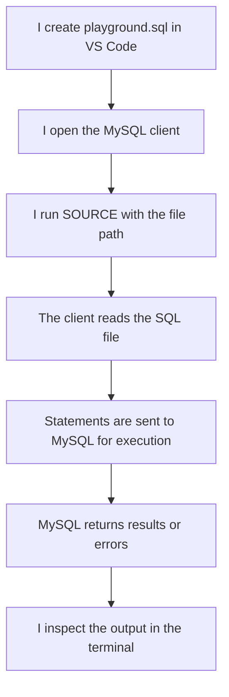

# Lesson 04 — MySQL Installation and Setup

## Why Am I Learning This?

I have started learning SQL, and I can write commands such as `CREATE`, `INSERT`, and `SELECT`.

But writing SQL is only one part of the process. I also need a database system that can execute those commands and manage my data.

That is where MySQL comes in.

I want to understand what I have installed on my computer, how I connect to it, where my SQL commands actually run, and how I can work with my databases without getting confused by the terminal.

I am not learning these tools just to get them working once. I want to understand my setup well enough that I can use it confidently while building backend applications later.

## What Am I Going to Learn?

By the end of this lesson, I want to understand:

- The difference between SQL and MySQL.
- What a database server does.
- The difference between MySQL Server, MySQL Client and MySQL Workbench.
- How my terminal communicates with MySQL.
- How to connect to MySQL and select a database.
- How to check whether MySQL is working correctly.
- How to execute an SQL file using `SOURCE`.
- How to exit the MySQL command-line client.

---

## 1. SQL vs MySQL — What Is the Difference?

These two names sound similar, but they are not the same thing.

### SQL is the language

SQL stands for Structured Query Language.

It is the language I use to tell a relational database what I want to do.

For example:

```sql
SELECT * FROM students;
```

This is an SQL query. It asks the database to retrieve all columns and rows from the `students` table.

### MySQL is the database management system

MySQL is a relational database management system (RDBMS) that understands SQL and manages databases.

It stores data, executes SQL statements, manages connections and enforces database rules.

I can think of it this way:

```text
SQL
│
└── The language I use to communicate

MySQL
│
└── The database system that processes my SQL
```

SQL is not exclusive to MySQL. Other database systems, such as PostgreSQL and Microsoft SQL Server, also support SQL, although their syntax and features differ.

**What I should remember:** SQL is the language; MySQL is one system that uses it.

---

## 2. What Actually Happens When I Run SQL?

This is the most important part of understanding my setup.

When I open a terminal and enter:

```sql
SELECT * FROM students;
```

MySQL is not simply displaying text that I typed. A database system receives the query, processes it, accesses the relevant table and returns the result.

Here is the basic flow:



Let me understand each part.

**Me:** I decide what information I want.

**MySQL Client:** It lets me enter SQL commands and sends them to the server.

**MySQL Server:** It receives the SQL, processes the request and manages access to the database.

**Result:** The client displays the server's response in my terminal.

For example, when I execute:

```sql
SELECT name FROM students;
```

the server processes the query and returns the matching names. The client displays those results.

This distinction will become especially useful when I connect MySQL to a Node.js or Express backend.

---

## 3. MySQL Server vs MySQL Client vs MySQL Workbench

I should not treat all MySQL tools as the same thing.

### MySQL Server

The server is the component that manages the databases and processes SQL queries.

It runs as a service on my computer or on another machine.

On a typical local Windows installation, the server is often accessible through `localhost`.

### MySQL Client

The command-line client allows me to connect to the server, enter SQL commands and inspect results.

This is the environment in which I have been practising commands such as:

```sql
USE sql_learning;
SHOW TABLES;
SELECT * FROM students;
```

### MySQL Workbench

MySQL Workbench is a graphical application for working with MySQL.

It can provide a query editor, a visual view of database objects and tools for administration.

It is an alternative interface, not a replacement for understanding SQL.

I can learn SQL through the command line, Workbench or another SQL editor. The queries and concepts are largely the same, although the surrounding interface differs.

### How these pieces fit together

```text
My Computer
│
├── MySQL Server
│   └── Manages databases and executes queries
│
├── MySQL Command-Line Client
│   └── Lets me type SQL commands
│
└── MySQL Workbench (optional)
    └── Provides a graphical interface
```

The server and client are separate roles, even if they are installed on the same computer.

---

## 4. Understanding the MySQL Command-Line Interface

When I enter the MySQL client, I may see something like this:

```text
mysql>
```

This is the **MySQL prompt**. It tells me that the client is ready to accept input.

It is different from my regular Windows terminal prompt.

For example, I might see:

```text
C:\Users\MyUser>
```

or a PowerShell prompt such as:

```text
PS C:\Users\MyUser>
```

Those are operating-system shell prompts.

The distinction matters because commands accepted by one environment may not be accepted by the other.

### Windows terminal vs MySQL prompt

| Command | Where I normally run it |
|---|---|
| `mysql -u root -p` | Windows terminal or PowerShell |
| `USE sql_learning;` | MySQL prompt |
| `SHOW DATABASES;` | MySQL prompt |
| `SOURCE D:/path/to/file.sql;` | MySQL prompt |
| `exit` | MySQL prompt, to leave the client |

For example, this command starts the MySQL client from a Windows terminal:

```bash
mysql -u root -p
```

The options mean:

- `mysql` launches the command-line client.
- `-u root` specifies the MySQL username.
- `-p` tells the client to prompt for the password.

The username `root` is only an example. I should use the username configured for my installation.

Once connected, I should see the `mysql>` prompt and can start executing SQL commands.

**Important:** I enter my password at the password prompt, not as part of the command itself. The terminal may not show any characters while I type the password; that is normal.

---

## 5. Connecting to MySQL

If MySQL is already installed and running, I do not need to reinstall it just to practise this lesson.

From PowerShell or Command Prompt, I can try:

```bash
mysql -u root -p
```

After entering my password, I should reach the MySQL prompt.

If the command is not recognized, the client may not be on my Windows `PATH`. That does not automatically mean MySQL is not installed.

If the connection fails, I should check whether the MySQL service is running and whether the username, password, host and port are correct.

For a typical local setup, the host is `localhost` and the default MySQL port is `3306`, unless the installation uses different settings.

### How do I know I am connected?

Run:

```sql
SELECT VERSION();
```

This asks MySQL to return the server version.

Then run:

```sql
SELECT DATABASE();
```

This returns the database currently selected by my session. If I have not selected one, the result can be `NULL`.

These are useful checks because they tell me that I am communicating with MySQL and show which database context I am using.

---

## 6. Understanding the Commands I Use to Navigate MySQL

Some commands do not create or modify tables. They help me inspect the environment and choose where I want to work.

### Show the available databases

```sql
SHOW DATABASES;
```

This displays databases that my MySQL account is permitted to see.

### Select a database

```sql
USE sql_learning;
```

This tells MySQL that `sql_learning` is the database I want to work with in my current session.

It does not create the database. It selects an existing one.

### Show the tables

```sql
SHOW TABLES;
```

After selecting a database, this displays its tables.

### Inspect a table's structure

```sql
DESCRIBE students;
```

This shows information such as the column names, data types and key settings for the `students` table.

### View stored records

```sql
SELECT * FROM students;
```

This retrieves all columns and rows from the table.

The commands above answer different questions:

| Command | Question it answers |
|---|---|
| `SHOW DATABASES;` | Which databases can I see? |
| `USE sql_learning;` | Which database do I want to work in? |
| `SHOW TABLES;` | Which tables are in the selected database? |
| `DESCRIBE students;` | What is the structure of this table? |
| `SELECT * FROM students;` | What records are stored in this table? |

---

## 7. What Does SOURCE Do?

This is particularly important because I will keep writing SQL in separate `.sql` files throughout this project.

So far, I could type commands directly into the MySQL prompt. That works, but it becomes inconvenient when a lesson contains many statements.

Instead, I can save the commands in a file such as:

```text
playground.sql
```

Then I can ask the MySQL command-line client to execute the statements in that file.

For example:

```sql
SOURCE D:/OneDrive/Code/SQL-Mastery/01-Relational-Database-Foundations/L03-SQL-Command-Categories/playground.sql;
```

### What happens when I run SOURCE?



The `SOURCE` command is a feature of the MySQL command-line client. It is not an SQL statement that I would normally put inside my `.sql` lesson file.

The file path identifies the script that I want to run. On Windows, forward slashes are convenient in MySQL paths.

### One important thing to understand

`SOURCE` executes the statements in the file. It does not automatically reset the database before executing them.

For example, if the file contains:

```sql
INSERT INTO students (id, name, age)
VALUES (1, 'John Cena', 21);
```

running the file again attempts to insert that record again.

If the table has a primary key on `id`, the repeated insert may produce a duplicate-key error. If it has no such constraint, duplicate records may be inserted.

Therefore, before rerunning a script, I should understand whether its statements are safe to execute more than once.

---

## 8. Understanding MySQL Errors

Errors are part of learning. They tell me that MySQL could not perform an operation as requested.

For example, suppose I run:

```sql
USE database_that_does_not_exist;
```

MySQL will report an error because the requested database cannot be selected.

Or suppose I try to create a table that already exists without handling that situation. MySQL may report an error instead of creating it again.

When I see an error, I should ask:

1. Which statement caused the error?
2. Was I at the MySQL prompt or the Windows terminal?
3. Does the database or table exist?
4. Did I select the correct database?
5. Have I already run this script before?
6. Is the command valid for MySQL?

I should not immediately delete a table or database just to make an error disappear. First, I need to understand what the error means and what data might be affected.

---

## 9. My Setup Verification Checklist

I can use the following commands to verify my local MySQL environment.

Run these from the `mysql>` prompt, one at a time:

```sql
SELECT VERSION();

SHOW DATABASES;

USE sql_learning;

SELECT DATABASE();

SHOW TABLES;
```

I should understand the purpose of each statement rather than merely copying it.

- `SELECT VERSION();` checks the MySQL server version.
- `SHOW DATABASES;` lists databases visible to my account.
- `USE sql_learning;` selects the existing learning database.
- `SELECT DATABASE();` confirms the currently selected database.
- `SHOW TABLES;` lists tables in the selected database.

If my existing database has a different name, I should use that name instead of creating another database unnecessarily.

---

## 10. What I Have Learned

I now understand the basic environment in which I will practise SQL.

- SQL is the language; MySQL is the database management system.
- The server manages the database and processes queries.
- The command-line client lets me interact with the server through a terminal.
- MySQL Workbench is an optional graphical interface.
- The `mysql>` prompt is different from the Windows terminal prompt.
- `USE` selects a database, while `SHOW DATABASES` lists databases.
- `SOURCE` executes SQL statements stored in a file.
- Rerunning a script can change existing data or produce errors.
- I should investigate errors before deleting anything.

## What Comes Next?

In Lesson 05, I will learn important database terminology, including schemas, indexes, primary keys and other concepts that I will keep encountering throughout SQL and backend development.

The goal is not to memorize a list of definitions. It is to understand the vocabulary well enough that I can follow database explanations and understand how real applications store and retrieve information.